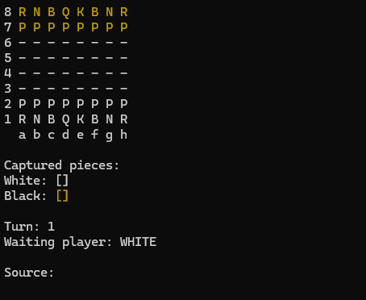

# Chess System Java

A **two-player chess game for the terminal**, built in Java to practice **object-oriented programming, domain modeling, and game-rule implementation**.

**Tech:** Java · Object-Oriented Programming · Standard Library

## Demo



The game runs in the terminal. Players enter the source and target squares for each move, and the application displays the board, current turn, possible moves, and captured pieces.

## Features

- Local, turn-based chess for two players.
- Movement and capture rules for all six piece types.
- Validation of selected pieces and destination squares.
- Prevention of moves that would leave the current player's king in check.
- Detection of **check** and **checkmate**.
- Special moves: **castling**, **en passant**, and **pawn promotion**.
- Display of possible moves and captured pieces in the terminal.
- Error handling for invalid input and illegal moves.

## Project structure

The code separates general board mechanics from chess-specific rules:

```text
src/
├── application/         # Entry point and console presentation
├── boardgame/           # Generic board, pieces, positions, and board exceptions
└── chess/               # Match management, chess positions, and game rules
    └── pieces/          # Movement logic for each chess piece
```

**Design highlights**

- **Encapsulation:** board state and match operations are managed through dedicated classes.
- **Inheritance and polymorphism:** individual piece types specialize common behavior.
- **Abstraction:** generic board operations are separated from chess rules.
- **Exceptions:** invalid moves and positions are reported through domain-specific errors.
- **Collections and matrices:** used to represent board positions and keep track of pieces.

## Running locally

**Requirements:** Java JDK (version 17 or newer recommended).

Clone the repository:

```bash
git clone https://github.com/YSVenturin/chess-system-java.git
cd chess-system-java
```

Compile the source files:

```bash
javac -d out -sourcepath src src/application/Program.java
```

Run the application:

```bash
java -cp out application.Program
```

Alternatively, open the project in a Java IDE and run the `application.Program` class.

> **Terminal note:** a terminal with ANSI color support (such as Git Bash on Windows) is recommended for the board display.

## How to play

1. Start the application. The white pieces move first.
2. Enter a **source** square, such as `e2`.
3. Enter a **target** square, such as `e4`.
4. Continue alternating turns until checkmate.

The application uses algebraic board coordinates (`a1` to `h8`) and prompts for one position at a time.

## What I practiced

- Modeling a domain using classes, abstract classes, and enums.
- Organizing responsibilities across packages.
- Applying inheritance, method overriding, and polymorphism.
- Implementing rule validation and handling invalid operations.
- Using collections and two-dimensional arrays.
